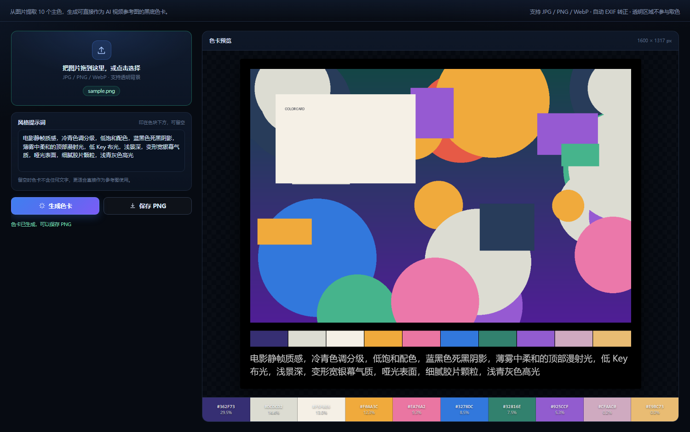

# AI 创作工具箱（开源版）

一个 Windows 桌面小工具箱，当前包含两个本地工具：

- **素材巢 AssetNest**：按「剧本 / 人物 / 场景 / 道具 / 音频 / 视频 / 成片」组织一部片子的素材，支持拖放、缩略图、视频首帧、音频波形、提示词与生成参数读取、评分标签备注、外部改动自动同步。
- **色卡生成器**：从图片提取 10 个主色，生成 1600px 宽的黑底色卡 PNG，可作为 AI 视频参考图。

全部在本机运行，不联网、不上传内容。




## 不包含的模块

H3 提示词医生、提示词框架工作台属于**第三方内容**，本仓库不包含它们的代码与文案，也不分发它们的安装包。请不要把包含这两个模块的完整版压缩包上传到公开 Releases。

如果你拥有这两个模块的授权，可以自行把页面放进 `web/`，并在 `web/shell.html` 里注册导航项；开源版的外壳默认只注册了素材巢和色卡，不包含这两个模块的接入配置。

## 功能

### 素材巢

- 七类固定目录：剧本 / 人物 / 场景 / 道具 / 音频 / 视频 / 成片
- 左侧文件夹树、右侧预览网格、右侧检查器
- 图片缩略图、视频首帧、音频真实波形
- 拖放导入、拖到分类节点归档、拖拽移动、撤销
- 读取 Stable Diffusion WebUI / ComfyUI / InvokeAI / Civitai / safetensors 生成参数
- 评分、收藏、标签、备注
- 外部文件夹改动约 2 秒自动同步
- 删除走 Windows 回收站

### 色卡生成器

- 支持 JPG / PNG / WebP，EXIF 自动转正
- 透明区域不参与取色
- median-cut 主色聚类，输出 10 色
- 1600px 宽 PNG，黑底、原图 + 色块条 + 可选风格提示词
- 拖入图片即可生成，保存走系统对话框

### 外壳

- 单窗口、侧栏切换
- 工具顺序可自定义：点击「自定义顺序」用 ↑ ↓ 调整，或直接拖拽；顺序会记住
- 素材巢激活时侧栏自动收成图标栏，给它自己的文件树让空间
- 素材巢的本地服务随工具箱启动/退出，异常退出后可一键重启

## 系统要求

- Windows 10 / 11（64 位）
- [Microsoft Edge WebView2 Runtime](https://go.microsoft.com/fwlink/p/?LinkId=2124703)（Win10/11 一般已自带）
- 从源码构建额外需要：.NET Framework 4.8、Python 3.10+（建议 3.12）

## 下载

到本仓库的 **Releases** 页面下载最新的 `AI-Creation-Toolbox-win64.zip`，解压后双击 `AI创作工具箱.exe`。

> exe 需要和同目录的 dll、`web`、`vendor` 文件夹一起使用，不能只拷 exe。

## 从源码构建

```powershell
# 1. 还原 WebView2 SDK（从 NuGet 下载）
powershell -ExecutionPolicy Bypass -File scripts\fetch-webview2.ps1

# 2. 构建素材巢（需要 Python 3.10+）
python -m pip install pyinstaller pillow
powershell -ExecutionPolicy Bypass -File scripts\build-assetnest.ps1

# 3. 构建工具箱
powershell -ExecutionPolicy Bypass -File build.ps1 -SkipAssetNest
```

产物在 `dist\AI创作工具箱`。

可选的 GitHub Actions 构建模板在 `docs/ci/github-actions-build.yml`；启用时把文件复制到 `.github/workflows/build.yml` 再 push 即可。首次发布前建议手动跑一遍构建确认依赖版本。

也可以直接运行：

```powershell
powershell -ExecutionPolicy Bypass -File build.ps1
```

它会自动还原依赖并构建素材巢。

## 目录结构

```text
.
├─ src/                     C# WinForms + WebView2 宿主
│  ├─ Host.cs
│  ├─ AssemblyInfo.cs
│  └─ app.manifest
├─ web/                     前端界面
│  ├─ shell.html            外壳 / 侧栏 / 工具切换
│  └─ colorcard/            色卡生成器
├─ modules/assetnest/       素材巢源码（Python + 原生 JS）
├─ scripts/                 还原依赖 / 构建脚本
├─ assets/app.ico
├─ build.ps1
├─ 使用说明.txt
└─ docs/screenshots/
```

## 架构

- **宿主**：C# WinForms，内嵌 WebView2。通过 `SetVirtualHostNameToFolderMapping` 把本地 `web/` 映射成 `https://app.local`，用 iframe 承载各工具。
- **工具间桥接**：`window.chrome.webview.postMessage` + `CoreWebView2Frame` 回包，处理复制、粘贴、保存文本、保存图片、打开文件等原生能力。
- **素材巢**：Python 本地 HTTP 服务（仅监听 `127.0.0.1` 随机端口），宿主在首次切换到素材巢时启动子进程，关闭工具箱时用 `taskkill /T` 结束整棵进程树。
- **色卡生成器**：纯前端 Canvas + median-cut 聚类，导出 PNG 后通过宿主保存对话框写盘。

## 数据与隐私

| 路径 | 用途 |
| --- | --- |
| `%LOCALAPPDATA%\AICreationBox-OSS` | 窗口位置、WebView2 缓存、localStorage |
| `%LOCALAPPDATA%\AssetNest` | 素材巢的评分、标签、备注、最近项目、缓存 |

- 不联网、无遥测、无账号
- 素材巢只监听 `127.0.0.1`，不要把它暴露到公网
- 删除程序文件夹即可卸载；彻底清理再删除上面两个目录

## 自定义工具顺序

侧栏「创作工具」右侧点击 **自定义顺序**，用 ↑ ↓ 调整后保存；也可以直接拖拽工具项。顺序保存在 localStorage，下次打开保持。

## 添加自己的模块

1. 在 `web/` 下新建一个目录，放入你的页面
2. 在 `web/shell.html` 里加导航项、iframe 和对应配置
3. 如果需要原生能力，在 `src/Host.cs` 的 `HandleHostMessage` 里加命令

注意：只添加你有权分发的代码和内容。

## 许可证

本项目采用 **MIT License**，详见 [LICENSE](LICENSE)。

第三方组件与商标说明见 [THIRD_PARTY_NOTICES.md](THIRD_PARTY_NOTICES.md)。

## 说明

- 本项目是非官方工具，与 MiniMax、H3 等第三方无隶属关系。
- 素材巢模块由作者提出产品构想与需求，并使用 AI 辅助编写；以 MIT 许可证随本项目发布。
- 本项目不调用任何模型接口，不生成视频。

## 贡献

见 [CONTRIBUTING.md](CONTRIBUTING.md)。提交前请确认你没有引入无权分发的第三方代码、文案或素材。
