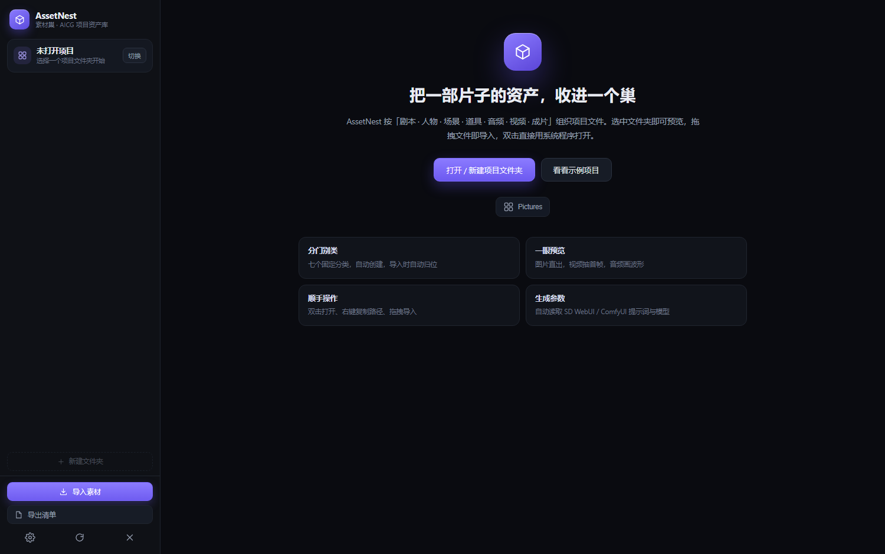

# AssetNest · 素材巢

> 本目录是 **AI 创作工具箱（开源版）** 的素材巢模块源码，随主项目以 MIT License 发布。
> 也可以单独运行：`python app.py`，或 `python app.py --no-window --port 47821`。

一款给 AICG 创作者用的 **项目资产整理桌面软件**。按「剧本 / 人物 / 场景 / 道具 / 音频 / 视频 / 成片」组织一部片子的素材，左边文件夹树、右边预览区。文件可以直接拖到左侧对应的分类节点上，本地文件夹被其他软件改动时界面也会自动同步。



## 它解决什么问题

做 AI 短片 / 漫剧 / 广告时，素材散落在 `Downloads`、`ComfyUI/output`、剪辑软件的代理目录里，找一张人物设定图要翻半天。AssetNest 把「一个项目」变成一个固定结构的文件夹，并给这些文件加上预览、标签、评分和生成参数。

## 快速开始

**方式一：直接运行打包好的程序**

```
运行  python app.py
或双击打包后的  dist\AssetNest.exe
```

**方式二：从源码运行（需要 Python 3.10+）**

```powershell
python app.py            # 打开独立应用窗口
python app.py --no-window --port 47821   # 只启动本地服务，用浏览器访问
```

首次启动会让选择一个**项目文件夹**。选定后会自动创建七个分类目录：

```
你的项目/
├─ 剧本/    分镜脚本、提示词、文案（txt / md / pdf / docx）
├─ 人物/    角色设定、三视图、立绘
├─ 场景/    场景概念图、氛围图
├─ 道具/    道具、物件、特写
├─ 音频/    配音、BGM、音效
├─ 视频/    生成的视频、运镜片段
└─ 成片/    剪辑成片、交付版本
```

已有文件夹不会被改动，只补建缺失的分类目录。想看效果可以点欢迎页的「看看示例项目」，会在 `文档/AssetNest 示例项目` 生成一套演示素材。

## 界面

```
┌───────────────┬─────────────────────────────────────┬──────────────┐
│ 项目卡片       │ 面包屑 · 搜索 · 类型筛选 · 排序 · 密度 │ 素材信息      │
│               ├─────────────────────────────────────┤              │
│ 文件夹树       │                                     │ 大图 / 首帧   │
│  项目          │        预览网格（等高行）             │ 提示词        │
│   剧本 2       │                                     │ 生成参数      │
│   人物 4       │                                     │ 标签 / 评分   │
│   场景 3       │                                     │ 备注          │
│   …           │                                     │              │
└───────────────┴─────────────────────────────────────┴──────────────┘
```

- **左侧**：项目、七个分类、分类下任意层级的子文件夹（人物可以一人一个文件夹），每个节点带数量。
- **右侧预览区**：图片直接显示缩略图；视频显示首帧封面 + 时长 + 播放角标；音频显示真实波形图（按文件解码绘制，不是假图）。
- **检查器**：点选素材后从右侧滑出，可看大图、正向/负向提示词、模型、步数、采样器、种子、CFG、LoRA，也能贴标签、打星、写备注。

## 操作

| 操作 | 说明 |
| --- | --- |
| 双击文件 | 用系统默认程序打开（PS / 剪映 / PotPlayer…） |
| 右键文件 | 复制路径、复制文件名、复制提示词、在资源管理器中显示、重命名、删除 |
| 拖到左侧分类节点 | 拖外部文件到「人物」「场景」「音频」等节点上，节点高亮，松开即导入该目录 |
| 从右侧拖到左侧 | 把右侧素材拖到左侧分类/子文件夹，文件在磁盘上真实**移动**；多选后拖一个即移动全部；顶部提示「松开以移动 · 「场景」」，完成后可点「撤销」 |
| 新建文件夹 | 左侧树下方「＋ 新建文件夹」按钮（或 `Ctrl+Shift+N`）。弹窗里是**从「此电脑」开始的位置浏览器**：盘符 → 目录逐级进入，也可用「项目目录」一键回到项目；下方实时显示完整创建路径。选到项目外也能创建，完成后可一键「设为项目」 |
| 拖进窗口 | 导入到当前选中的文件夹；在项目根节点拖入则按类型自动归档 |
| 拖入文件夹 | 保留子目录层级（例如整个角色文件夹拖进「人物」） |
| 外部写入 | ComfyUI 出图、剪映导出、资源管理器里新建/改名/删除，2 秒左右自动同步到界面 |
| 点击分类节点 | 只看该分类；点项目根节点看全部资产 |


| 勾选「含子目录」 | 连子文件夹里的素材一起列出来 |
| `空格` | 灯箱预览（图片可滚轮缩放、拖动、双击复位；视频直接播放） |
| `Enter` / `F2` / `Del` | 打开 / 重命名 / 删除（进回收站） |
| `1`–`5` / `F` | 评分 / 收藏 |
| `/` | 聚焦搜索 |
| 方向键 | 在网格里移动选中项 |
| `Ctrl / Shift + 点击` | 多选，批量收藏、复制路径、加标签、删除 |

删除默认走 Windows 回收站，可以还原；只有回收站不可用时才会失败并提示。

## 自动读取生成参数

- **Stable Diffusion WebUI / Forge**：解析 PNG 的 `parameters` 文本块（含 Negative prompt、Steps、Sampler、CFG、Seed、Model、LoRA 标签）。
- **ComfyUI**：解析 PNG 内嵌的 `prompt` / `workflow` JSON，顺着 KSampler 的正负条件反查文本节点，识别 Checkpoint 与 LoRA。
- **InvokeAI / Civitai**：支持 `sd-metadata`、`.civitai.info`、同名 `.txt` / `.json` 旁车文件。
- **safetensors**：读取头部 `__metadata__` 里的 `ss_` 字段（触发词、网络维度、底模版本）。

## 外部写入实时同步

不需要点刷新。后台每 2 秒比对一次项目目录的指纹（路径 + 大小 + 修改时间），一旦发现变化就把新的文件夹树和当前目录列表推给界面：

- ComfyUI / WebUI 把新图直接输出到「人物」里 → 缩略图自动出现
- 在资源管理器里删除、改名、新建子文件夹 → 左侧树的数量和右侧列表跟着变
- 正在编辑重命名输入框、备注，或有弹窗打开时，会暂停自动刷新，避免打断你

同步只在本地进行，不上传、不改动你的文件。想立刻刷新也可以按 `R` 或点左下角刷新按钮。

## 数据与缓存

| 路径 | 用途 |
| --- | --- |
| `%LOCALAPPDATA%\AssetNest\assetnest.db` | 评分、收藏、标签、备注、最近项目、设置 |
| `%LOCALAPPDATA%\AssetNest\cache\thumbs` | 缩略图 / 视频封面（WebP） |
| `%LOCALAPPDATA%\AssetNest\cache\peaks` | 音频波形峰值 |
| `%LOCALAPPDATA%\AssetNest\browser` | 独立浏览器配置（应用窗口用） |

素材文件本身**从不移动、不复制、不改名**，除非你自己点了重命名/删除。

## 视频封面说明

优先用 FFmpeg 抽首帧（在「设置」里填 `ffmpeg.exe` 路径，或加入 PATH）。没有 FFmpeg 时，应用会让内置浏览器内核解码视频、跳到 15% 处抓一帧并缓存成 WebP，所以开箱即用。两种方式生成的封面都缓存在本地，第二次打开就不用再算。

## 打包成 exe

```powershell
python -m pip install pyinstaller pillow
.\build.ps1
```

产物在 `dist\AssetNest.exe`（单文件，约 31 MB），双击即用；Web 资源已内嵌，运行时解压到临时目录。

## 目录结构

```
AssetNest/
├─ app.py                 启动器：本地服务 + 独立窗口 + 文件夹选择框
├─ build.ps1              PyInstaller 打包脚本
├─ make_icon.py           生成 ico / png 图标
├─ backend/
│  ├─ api.py              业务接口：项目、文件、元数据、导入、导出
│  ├─ project.py          项目模型：七类目录、文件夹树、文件操作
│  ├─ store.py            SQLite：设置、最近项目、评分/标签/备注
│  ├─ meta.py             生成参数解析（A1111 / ComfyUI / safetensors）
│  ├─ thumbs.py           缩略图、视频首帧、音频波形渲染
│  ├─ paths.py            路径常量与系统调用（回收站、资源管理器）
│  └─ server.py           本地 HTTP 服务与静态资源
└─ web/                   前端（原生 JS，无构建步骤）
   ├─ index.html
   ├─ css/app.css
   └─ js/app.js
```

## 常见问题

**Q：窗口没弹出来？**
看 `%LOCALAPPDATA%\AssetNest\assetnest.log`（如果存在），或改用 `python app.py --no-window --port 47821`，再手动打开 `http://127.0.0.1:47821`。

**Q：视频没有封面？**
先把文件选中，等 1–2 秒让浏览器抓帧；或在设置里指定 ffmpeg。极少数编码（如 ProRes、HEVC 无解码器）可能抓不到，此时显示占位图标，不影响双击打开。

**Q：能管理多个项目吗？**
可以。左下角「切换」选择另一个项目文件夹，最近项目会记住，评分/标签按文件路径区分。

**Q：支持 Mac 吗？**
目前只针对 Windows 做了窗口与回收站调用，代码结构上可以移植（`paths.py` 里有系统分支）。
